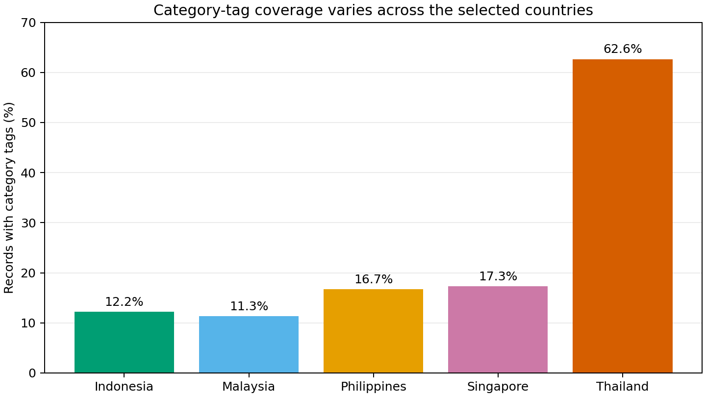
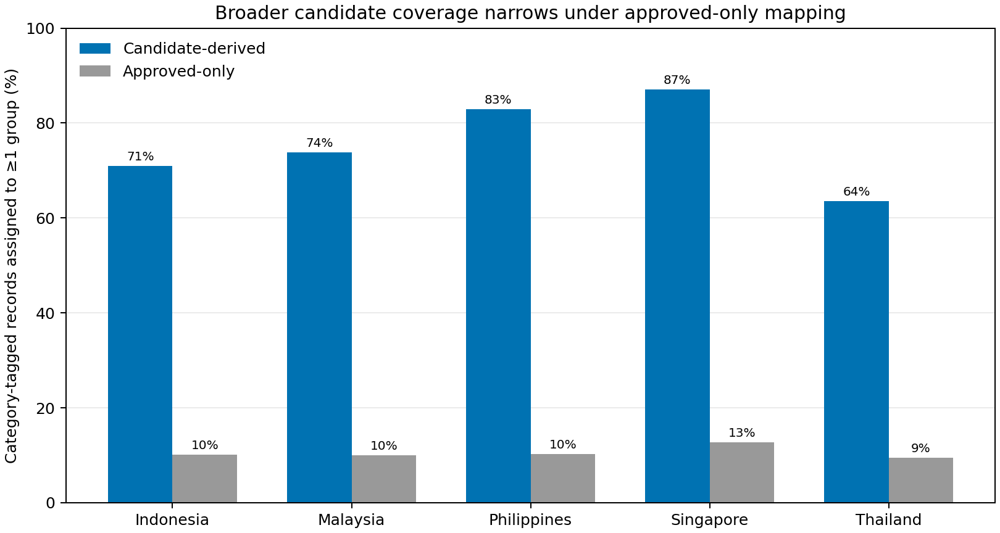

# Indonesia Food Product Landscape

How much product data exists for Indonesia, and how completely is it described — answered from one pinned Open Food Facts snapshot, and not a measure of market size, sales, or share.

**Verify in 60 seconds:** every headline number and all five charts are committed and asserted in CI — [rebuild and check them without the 8 GB download](docs/09_reproduction.md#quick-look-without-the-8-gb-download).

## 30-second summary

If you wanted to describe the Indonesian food market from open product data, how much of it would you actually have? In one fixed snapshot of Open Food Facts the answer is 9,118 Indonesian product records, of which 12.2% carry a category tag. That is close to Malaysia, below the Philippines and Singapore, and far below Thailand, which tags 62.6%.

For a business decision, the data works as a supplementary signal about which products are recorded and how completely they are described — not as a measure of what sells. Category assignments are provisional, and brand mapping is far too sparse to describe a competitive landscape.

## Key results

<!-- AUTO-GENERATED: headline-metrics:START -->
- **Category coverage:** 12.2% of Indonesian records are tagged, versus 11.3%–17.3% in the comparison countries and 62.6% in Thailand, the high-coverage contrast.
- **Category assignments in Indonesia:** 788 of 1,111 tagged records (70.9%) receive at least one candidate-derived group; 113 (10.2%) do under the stricter approved-only view.
- **Brand evidence:** raw brand text is present for 38.8% of Indonesian records, while exact-approved mapping covers only 0.34%.
- **AI + online mapping audit:** 97/130 candidate assignments were judged correct on a targeted, non-random sample; this is a diagnostic, not human ground truth (details in Method quality and the findings and recommendations).
<!-- AUTO-GENERATED: headline-metrics:END -->

*Figure 1 — Only 12% of Indonesian records carry a category tag, versus 63% in Thailand. How to read this: taller bars mean more completely tagged data, not a bigger market.*

## What this demonstrates

- **Auditing whether data is fit for a decision.** The study measures which fields a decision needs and how often they are populated, instead of assuming a dataset is usable because it is large.
- **Honest scoping.** It states plainly what the data cannot support — market size, sales, demand, share, availability — rather than implying that coverage equals commercial insight.
- **Reproducible, tested analysis.** Every headline number is asserted in CI against committed outputs, and every chart is regenerated from those outputs rather than drawn by hand.

*Decisions this supports:* what to use this data for, at what effort, and what to commission first — see the [decision memo](docs/11_decision_memo.md).

## Country comparison

**Why these countries:** Indonesia is the study country; Malaysia (MY), the Philippines (PH), and Singapore (SG) are comparison countries chosen on documented coverage, category availability, source-snapshot alignment, and analytical relevance — not on record count ([business brief](docs/01_business_brief.md), section 1). Thailand (TH) is a high-coverage contrast, not an equivalent market peer.

"Assigned" means a record has at least one substantive reporting-group assignment; groups can overlap. "Share of all records" uses **all country records** as the denominator; tag coverage uses **tagged records** as the denominator.

<!-- AUTO-GENERATED: country-comparison:START -->
| Country | Role | Records | Category-tagged | Tag coverage | Candidate-derived assigned | Approved-only assigned | Candidate-derived, share of all records | Approved-only, share of all records |
|---|---|---|---|---|---|---|---:|---:|
| Indonesia (ID) | Study country | 9,118 | 1,111 | 12.18% | 788 (70.9%) | 113 (10.2%) | 8.64% | 1.24% |
| Malaysia (MY) | Comparison country | 7,426 | 840 | 11.31% | 620 (73.8%) | 84 (10.0%) | 8.35% | 1.13% |
| Philippines (PH) | Comparison country | 9,176 | 1,535 | 16.73% | 1,273 (82.9%) | 158 (10.3%) | 13.87% | 1.72% |
| Singapore (SG) | Comparison country | 11,986 | 2,074 | 17.30% | 1,806 (87.1%) | 263 (12.7%) | 15.07% | 2.19% |
| Thailand (TH) | High-coverage contrast | 11,343 | 7,104 | 62.63% | 4,516 (63.6%) | 673 (9.5%) | 39.81% | 5.93% |
<!-- AUTO-GENERATED: country-comparison:END -->

### Glossary in plain English

| Term | Plain meaning |
|---|---|
| Reporting group | One fixed food group used to compare category tags, such as Beverages or Cereals, potatoes & bakery. |
| Category-tagged / tag coverage | A record has at least one category tag; coverage is the tagged share of a country's records. |
| Candidate-derived assigned | Broad, automated, not-yet-verified: a record linked to a group by an automated or manual candidate mapping. |
| Approved-only assigned | Narrow, verified: a record linked only through mappings with a reviewed decision. |
| Exact-approved brand mapping | A brand name matched to a brand whose mapping is reviewed. Much narrower than having brand text. |
| Share of all records | A count divided by all of a country's records, not only its tagged records. |
| High-coverage contrast | Thailand is included because its tag coverage is far higher (62.6%), to show what well-tagged data looks like. It is not an equivalent market peer. |

*Figure 2 — In Indonesia, broad mapping assigns 71% of tagged records while strict mapping assigns 10%. How to read this: the gap between the two bars shows how much the answer depends on which mapping rule you accept.*

*Figure 3 — Sweet foods & desserts is the largest reporting group in 3 of 5 countries. How to read this: each bar is the biggest single group for that country as a share of all its records; groups can overlap, so bars are not additive.*

### Field readiness

Percentages are records with a non-empty field or valid value, using the definitions in [the reproduction guide](docs/09_reproduction.md). Numeric nutrition and valid A–E Nutri-Score are separate measures.

<!-- AUTO-GENERATED: readiness-scorecard:START -->
| Country | Brand text | Category tags | Ingredients | Numeric nutrition | Valid Nutri-Score | Packaging | Labels | Exact-approved brand map |
|---|---:|---:|---:|---:|---:|---:|---:|---:|
| Indonesia (ID) | 38.8% | 12.2% | 17.3% | 31.0% | 5.5% | 4.0% | 28.9% | 0.3% |
| Malaysia (MY) | 46.2% | 11.3% | 8.6% | 39.7% | 4.6% | 3.4% | 15.1% | 0.9% |
| Philippines (PH) | 60.4% | 16.7% | 13.8% | 52.2% | 10.9% | 4.6% | 10.1% | 1.0% |
| Singapore (SG) | 64.6% | 17.3% | 13.6% | 57.6% | 11.0% | 7.4% | 14.6% | 2.8% |
| Thailand (TH) | 80.4% | 62.6% | 55.6% | 81.2% | 45.6% | 29.9% | 17.2% | 0.4% |
<!-- AUTO-GENERATED: readiness-scorecard:END -->

*Figure 4 — The widest field gap for Indonesia is category tags: 12% versus 63% in Thailand. How to read this: darker cells mean more records carry a usable value for that field.*

*Figure 5 — Brand text covers 39% of Indonesian records; exact-approved mapping covers 0.34%. How to read this: the two bars measure different things and must not be read as one.*

## Fit for purpose

| Use case | Suitable? | Reason (from tracked outputs) |
|---|---|---|
| Audit which product fields are populated | Yes | Field-readiness scorecard per country (for example, Indonesia (ID) category tags 12.2%, brand text 38.8%). |
| Compare recorded category coverage across the five countries | Yes, descriptively | Country comparison table above, baseline scenario. |
| Classify Indonesian records into reporting groups | Limited | Candidate-derived assignments cover 788/9,118 records (8.64% of all records; 70.9% of tagged records); approved-only covers 113 (1.24%; 10.2%). |
| Estimate market size, sales, demand, or market share | No | The source has no sales or demand fields and is not a census. |
| Broad brand landscape, concentration (HHI), or dominance | No | Exact-approved mapping covers only 0.34% of Indonesian records—too sparse. |

## Five findings

1. **Coverage is uneven.** Indonesia's category-tag coverage is close to Malaysia (MY) and below the Philippines (PH) and Singapore (SG), and well below Thailand (TH). Thailand is a high-coverage contrast, not an equivalent market peer.
2. **Mapping choice changes the answer.** Candidate-derived assignments cover more tagged records than exact-approved assignments. Unassigned records remain visible; ambiguous tags are not forced into groups.
3. **Readiness depends on the field.** A record with brand text or a category tag is not necessarily complete or correct. Exact-approved brand mapping is much narrower than raw brand-text availability.
4. **Contributor and source metadata are diagnostics.** Concentration, creation-year patterns, and source-tag coverage describe the database's recorded contributions; they do not prove imports, bulk loading, or the cause of coverage differences.
5. **Identifier overlap is not market overlap.** Shared product codes may be the same source records assigned to multiple countries. They do not establish that products are sold or traded between those countries.

## Method quality

The AI-assisted mapping audit is a diagnostic, not human ground truth. On a targeted, non-random sample of 150 Indonesian records, 97 of 130 candidate assignments were judged correct, with exact group-set agreement of 61/150 (40.7%); a separate eight-record Meat & poultry census is reported descriptively. A targeted online follow-up covered the 48 cases that were incorrect, ambiguous, or under-evidenced. Because that follow-up is targeted and non-random, it is not a sample-wide precision estimate. Full intervals and per-group results are in the [findings and recommendations](docs/07_stage7_findings_and_recommendations.md).

## Scope and limitations

- Open Food Facts is collaborative, not a census or proof of country availability; it has no sales, revenue, market-share, or demand measures. Candidate assignments are exploratory, and approved-only assignments are narrower.
- The AI-assisted semantic audit is not human ground truth; `food_groups_tags` is a diagnostic cross-check, not an inference source.
- Contributor concentration and creation-time patterns are descriptive only. The snapshot does not include the Open Food Facts `sources.import_t` field, so this analysis cannot establish whether records arrived through a bulk import.
- Brand-text availability and exact-approved brand mapping are distinct. The mapped subset is too sparse for broad brand-concentration claims.
- The snapshot is pinned to a Hugging Face commit with a verified SHA-256; both values are recorded in [the source record](docs/02_data_source.md).

### What would change these conclusions

- **A newer pinned snapshot.** Coverage describes one commit; a later commit can move the 12.2% headline without any change in data quality.
- **Sales, panel, or retail-scan data.** It is the only input that turns recorded products into products sold, and the only route to a share or demand claim.
- **An approved taxonomy and reviewed mappings.** Closing the 106,211 unmatched tags and 838 multi-group tags would move candidate-derived assignments from provisional to approved.
- **A random-sample audit with intervals.** A probability sample would replace the targeted diagnostic with an estimate that carries a confidence interval.

## Reproduce and inspect

- **Just looking?** Every chart and headline number on this page is committed to the repo and can be regenerated and verified without the 8 GB download — see the [quick-look section](docs/09_reproduction.md#quick-look-without-the-8-gb-download).
- **Need a one-page brief?** The [client one-pager](docs/12_client_one_pager.md) covers the problem, approach, result, decision implications, and limits on a single page.
- [Repository architecture](docs/00_repository_architecture.md) maps the directory roles and source-of-truth rules; the [reproduction guide](docs/09_reproduction.md) covers requirements, definitions, and three example SQL queries; [claim lineage](docs/10_claim_lineage.md) traces each claim to its inputs and checks.
- [Business brief](docs/01_business_brief.md), [data source and licensing](docs/02_data_source.md), [release metadata](docs/08_github_release_metadata.md), and the [findings and recommendations](docs/07_stage7_findings_and_recommendations.md).

Original project code and documentation are MIT-licensed. Open Food Facts data and third-party references have separate terms; see the [source and licensing note](docs/02_data_source.md).

## About the author

[Maulana Kindi](https://www.linkedin.com/in/maulanakinditamami/) is a freelance data analyst and BI consultant. This study is a portfolio piece: it shows how I scope a data question, measure what the data can actually support, and keep every claim reproducible.

Services: data-fitness audits, KPI definition, SQL and DuckDB pipelines, and dashboards.

Contact: [maulanakindi@gmail.com](mailto:maulanakindi@gmail.com) · [LinkedIn](https://www.linkedin.com/in/maulanakinditamami/)