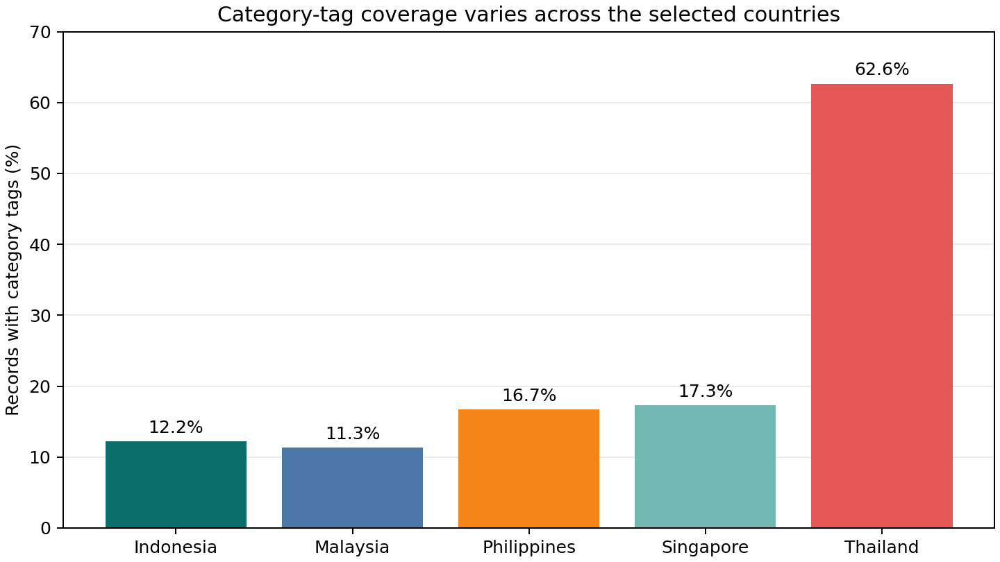
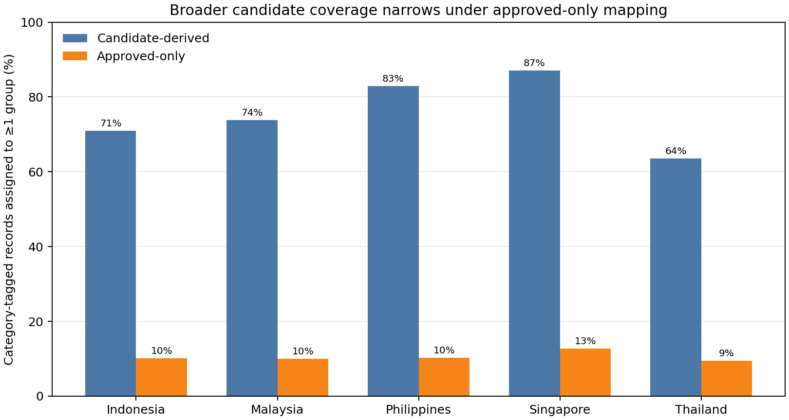
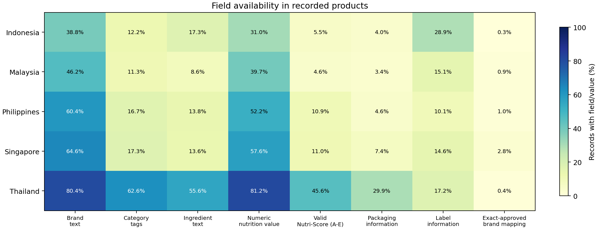
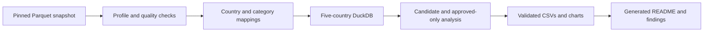

# Indonesia Food Product Landscape (In Revision)

An evidence-based comparison of product records and data coverage in a pinned Open Food Facts snapshot—not a measure of food-market size or sales.

## TL;DR

**Question:** Within the fixed snapshot, how do record counts, category-tag coverage, category assignments, and field readiness differ across Indonesia, contextual peers, and a separate higher-coverage contrast?

<!-- AUTO-GENERATED: headline-metrics:START -->
- **Category coverage:** 12.2% of Indonesian records are tagged, versus 11.3%–17.3% in the contextual peers and 62.6% in Thailand, the separate coverage contrast.
- **Category assignments in Indonesia:** 788 of 1,111 tagged records (70.9%) receive at least one candidate-derived group; 113 (10.2%) do under the stricter approved-only view.
- **Brand evidence:** raw brand text is present for 38.8% of Indonesian records, while exact-approved mapping covers only 0.34%.
- **AI + online mapping audit:** 97/130 candidate assignments were judged correct (26 also align with exact-reviewed mappings); 16 disagreed and 17 were unresolved. Exact group-set agreement was 61/150 (40.7%). Online follow-up found supporting product evidence for 30/48 cases; 36 have a source URL and 29 match the exact product code. Targeted, non-random, and not human ground truth; [AI audit](outputs/quality/category_mapping_semantic_audit_records.csv) · [online evidence](outputs/quality/category_mapping_online_evidence_audit.csv).
<!-- AUTO-GENERATED: headline-metrics:END -->

### Country comparison

“Assigned” means a record has at least one substantive reporting-group assignment. Groups can overlap. Candidate-derived mappings are not all approved.

<!-- AUTO-GENERATED: country-comparison:START -->
| Country | Role | Records | Category-tagged | Tag coverage | Candidate-derived assigned | Approved-only assigned | Exact-approved brand mapped |
|---|---|---:|---:|---:|---:|---:|---:|
| ID | Focal | 9,118 | 1,111 | 12.18% | 788 (70.9%) | 113 (10.2%) | 31 (0.34%) |
| MY | Contextual peer | 7,426 | 840 | 11.31% | 620 (73.8%) | 84 (10.0%) | 64 (0.86%) |
| PH | Contextual peer | 9,176 | 1,535 | 16.73% | 1,273 (82.9%) | 158 (10.3%) | 88 (0.96%) |
| SG | Contextual peer | 11,986 | 2,074 | 17.30% | 1,806 (87.1%) | 263 (12.7%) | 341 (2.85%) |
| TH | Coverage contrast | 11,343 | 7,104 | 62.63% | 4,516 (63.6%) | 673 (9.5%) | 46 (0.41%) |
<!-- AUTO-GENERATED: country-comparison:END -->





### Field readiness

Percentages are records with a non-empty field or valid value, using the definitions in [the reproduction guide](docs/REPRODUCE.md). Numeric nutrition and valid A–E Nutri-Score are separate measures.

<!-- AUTO-GENERATED: readiness-scorecard:START -->
| ISO | Brand text | Category tags | Ingredients | Numeric nutrition | Valid Nutri-Score | Packaging | Labels | Exact-approved brand map |
|---|---:|---:|---:|---:|---:|---:|---:|---:|
| ID | 38.8% | 12.2% | 17.3% | 31.0% | 5.5% | 4.0% | 28.9% | 0.3% |
| MY | 46.2% | 11.3% | 8.6% | 39.7% | 4.6% | 3.4% | 15.1% | 0.9% |
| PH | 60.4% | 16.7% | 13.8% | 52.2% | 10.9% | 4.6% | 10.1% | 1.0% |
| SG | 64.6% | 17.3% | 13.6% | 57.6% | 11.0% | 7.4% | 14.6% | 2.8% |
| TH | 80.4% | 62.6% | 55.6% | 81.2% | 45.6% | 29.9% | 17.2% | 0.4% |
<!-- AUTO-GENERATED: readiness-scorecard:END -->



## Five findings

1. **Coverage is uneven.** Indonesia's category-tag coverage is close to the contextual peers and well below Thailand. Thailand is a coverage contrast, not an equivalent market peer.
2. **Mapping choice changes the answer.** Candidate-derived assignments cover more tagged records than exact-approved assignments. Unassigned records remain visible; ambiguous tags are not forced into groups.
3. **Readiness depends on the field.** A record with brand text or a category tag is not necessarily complete or correct. Exact-approved brand mapping is much narrower than raw brand-text availability.
4. **Contributor and source metadata are diagnostics.** Concentration, creation-year patterns, and source-tag coverage describe the database's recorded contributions; they do not prove imports, bulk loading, or the cause of coverage differences.
5. **Identifier overlap is not market overlap.** Shared product codes may be the same source records assigned to multiple countries. They do not establish that products are sold or traded between those countries.

## Decision memo

**For an FMCG analyst considering Open Food Facts for Indonesia:**

- **Use it** as a supplementary signal for observed catalog coverage and for identifying which product fields are actually populated.
- **Do not use it alone** to estimate competitor share, market size, sales, demand, or product availability. The database is collaborative and is not a census.
- **Pair it with** representative retail or sales-panel data, e-commerce evidence, or suitable official statistics; validate products and mappings for the decision at hand.

## Method at a glance



Three example questions the database can answer:

```sql
-- How many country records have category tags?
SELECT country.iso_alpha2,
       COUNT(DISTINCT country.source_record_id) AS records,
       COUNT(DISTINCT category.source_record_id) AS category_tagged
FROM record_country AS country
LEFT JOIN record_category_tag AS category USING (source_record_id)
GROUP BY country.iso_alpha2
ORDER BY country.iso_alpha2;
```

```sql
-- How does exact-approved brand mapping compare with raw brand text?
SELECT country.iso_alpha2,
       COUNT(DISTINCT record.source_record_id)
           FILTER (WHERE NULLIF(trim(record.brands), '') IS NOT NULL)
           AS records_with_brand_text,
       COUNT(DISTINCT brand.source_record_id)
           FILTER (WHERE mapping.review_status = 'approved')
           AS records_with_exact_approved_mapping
FROM record_country AS country
JOIN source_product_record AS record USING (source_record_id)
LEFT JOIN record_brand_source_value AS brand USING (source_record_id)
LEFT JOIN brand_name_mapping AS mapping
    ON brand.source_brand_name = mapping.source_brand_name
GROUP BY country.iso_alpha2
ORDER BY country.iso_alpha2;
```

```sql
-- Compare candidate-derived and approved-only tagged-record assignment.
SELECT country.iso_alpha2,
       COUNT(DISTINCT category.source_record_id)
           FILTER (
               WHERE candidate.candidate_role IN (
                   'single_group_candidate',
                   'manual_group_assignment'
               )
               AND candidate.comparison_role = 'primary_candidate'
               AND candidate.reporting_group_id <> 'other_unclassified'
           )
           AS candidate_assigned_records,
       COUNT(DISTINCT category.source_record_id)
           FILTER (WHERE decision.selected_group_id IS NOT NULL)
           AS approved_only_assigned_records
FROM record_country AS country
JOIN record_category_tag AS category USING (source_record_id)
LEFT JOIN category_tag_group_candidate AS candidate
    USING (source_category_tag)
LEFT JOIN category_tag_group_decision AS decision
    USING (source_category_tag)
GROUP BY country.iso_alpha2
ORDER BY country.iso_alpha2;
```

## Scope and limitations

- Open Food Facts is collaborative, not a census or proof of country availability; it has no sales, revenue, market-share, or demand measures. Candidate assignments are exploratory, and approved-only assignments are narrower.
- The AI-assisted semantic audit is not human ground truth; `food_groups_tags` is a diagnostic cross-check, not an inference source.
- Contributor concentration and creation-time patterns are descriptive only. The snapshot does not include the Open Food Facts `sources.import_t` field, so this analysis cannot establish whether records arrived through a bulk import.
- Brand-text availability and exact-approved brand mapping are distinct. The mapped subset is too sparse for broad brand-concentration claims.
- The snapshot is pinned to Hugging Face commit `31f31c441274c095718cc88ae582030a5a615415`, with expected SHA-256 `DA39B2C5AAF1F85B2E637B904B5FC3A29780DD7E184254F4B660CFE0CD84999A`.

## Reproduce and inspect

- [Reproduction guide](docs/REPRODUCE.md): one-command workflow, requirements, data definitions, and SQL.
- [Stage 7 findings](docs/06_stage7_findings_and_recommendations.md): detailed generated results, diagnostics, interpretation, and caveats.
- [Data source and licensing](docs/01_data_source.md): pinned source, attribution, and third-party data conditions.
- [Business brief](docs/00_business_brief.md): objective, questions, scope, and measurement rules; [GitHub metadata and v1.0 release draft](docs/GITHUB_RELEASE_DRAFT.md), with the prepared [social preview](docs/img/social_preview.png).

Original project code and documentation are MIT-licensed. Open Food Facts data and third-party references have separate terms; see the [source and licensing note](docs/01_data_source.md).
