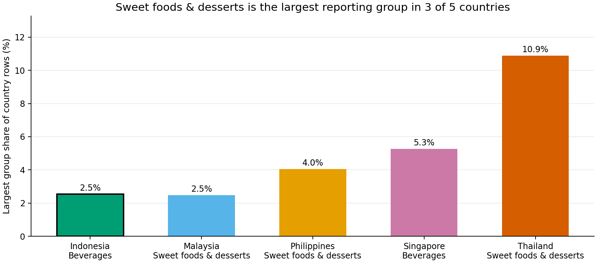
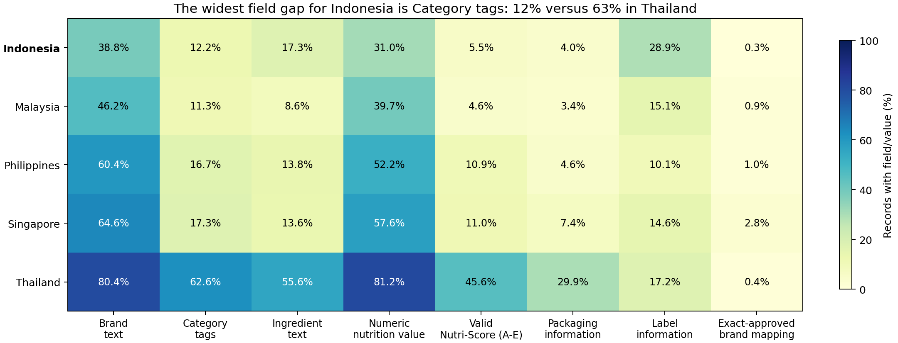
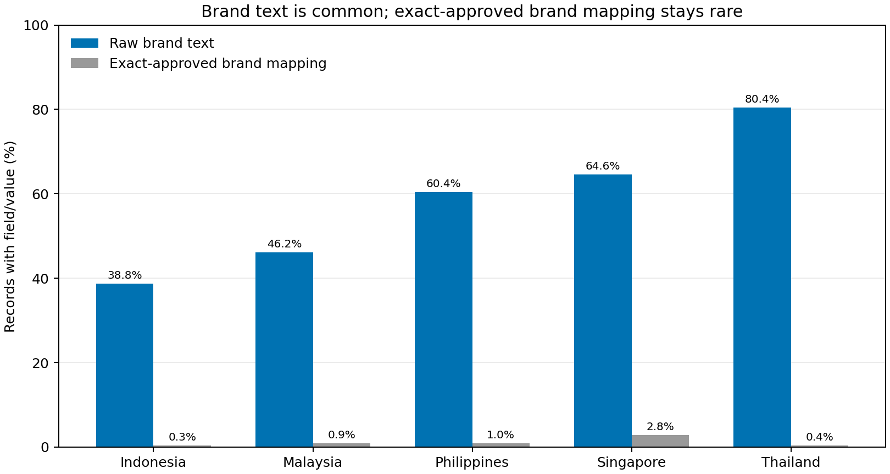
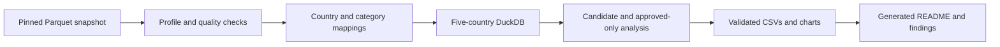

# Indonesia Food Product Landscape

An evidence-based comparison of product records and data coverage in a pinned Open Food Facts snapshot—not a measure of food-market size or sales.

## Bottom line

**Answer:** In one fixed Open Food Facts snapshot, Indonesia (ID) records 9,118 product rows and tags 12.2% of them with at least one category. Recorded category coverage in Indonesia is similar to Malaysia (MY) and somewhat below the Philippines (PH) and Singapore (SG), and far below Thailand (TH), a high-coverage contrast. This is a data-coverage study, not a market-size estimate.

**Why these countries:** Indonesia is the study country; Malaysia (MY), the Philippines (PH), and Singapore (SG) are comparison countries, and Thailand (TH) is a high-coverage contrast ([business brief](docs/01_business_brief.md), section 1). The brief selects peers on documented coverage and quality, relevant category availability, source-snapshot alignment, and analytical relevance—not on record count (section 6.6).

**Decisions this supports:**
- **Use** Open Food Facts as a supplementary signal for catalog coverage and field completeness—see [Fit for purpose](#fit-for-purpose).
- **Do not use it alone** for competitor share, market size, sales, demand, or availability; pair it with representative retail, sales-panel, or official data.
- **Treat category assignments as provisional:** candidate-derived assignments are broader than approved-only, and neither covers all tagged records.

**What this is / who it is for / how to read (60 seconds):** a data-coverage study of Open Food Facts for market-intelligence and FMCG (fast-moving consumer goods) analysts; read the headline numbers, then the country table, then the limitations.

## TL;DR

**Question:** In one fixed Open Food Facts snapshot, how much product data exists for Indonesia versus four comparison countries, and how completely is it described?

<!-- AUTO-GENERATED: headline-metrics:START -->
- **Category coverage:** 12.2% of Indonesian records are tagged, versus 11.3%–17.3% in the comparison countries and 62.6% in Thailand, the high-coverage contrast.
- **Category assignments in Indonesia:** 788 of 1,111 tagged records (70.9%) receive at least one candidate-derived group; 113 (10.2%) do under the stricter approved-only view.
- **Brand evidence:** raw brand text is present for 38.8% of Indonesian records, while exact-approved mapping covers only 0.34%.
- **AI + online mapping audit:** 97/130 candidate assignments were judged correct on a targeted, non-random sample; this is a diagnostic, not human ground truth (details in Method quality and the Stage 7 findings).
<!-- AUTO-GENERATED: headline-metrics:END -->

**Terms used here:** Open Food Facts = collaborative product database; record = one row in the snapshot (not necessarily a unique product); tag = a source country or category label; snapshot = one pinned download; country codes = ISO 3166-1 alpha-2.

*Figure 1 — Category-tag coverage by country. Bars show the share of records with at least one category tag; higher means more completely tagged, not a bigger market.*

### Country comparison

"Assigned" means a record has at least one substantive reporting-group assignment; groups can overlap. "Share of all records" uses **all country records** as the denominator; tag coverage uses **tagged records** as the denominator.

<!-- AUTO-GENERATED: country-comparison:START -->
| Country | Role | Records | Category-tagged | Tag coverage | Candidate-derived assigned | Approved-only assigned | Candidate-derived, share of all records | Approved-only, share of all records |
|---|---|---|---|---|---|---|---:|---:|
| Indonesia (ID) | Study country | 9,118 | 1,111 | 12.18% | 788 (70.9%) | 113 (10.2%) | 8.64% | 1.24% |
| Malaysia (MY) | Comparison country | 7,426 | 840 | 11.31% | 620 (73.8%) | 84 (10.0%) | 8.35% | 1.13% |
| Philippines (PH) | Comparison country | 9,176 | 1,535 | 16.73% | 1,273 (82.9%) | 158 (10.3%) | 13.87% | 1.72% |
| Singapore (SG) | Comparison country | 11,986 | 2,074 | 17.30% | 1,806 (87.1%) | 263 (12.7%) | 15.07% | 2.19% |
| Thailand (TH) | High-coverage contrast | 11,343 | 7,104 | 62.63% | 4,516 (63.6%) | 673 (9.5%) | 39.81% | 5.93% |
<!-- AUTO-GENERATED: country-comparison:END -->

**Reading the terms:**

| Term | Plain meaning |
|---|---|
| Reporting group | One fixed food group used to group category tags for comparison, such as Beverages, Sweet foods & desserts, or Cereals, potatoes & bakery. |
| Category-tagged / tag coverage | A record has at least one category tag; coverage is the tagged share of a country's records. |
| Candidate-derived assigned | A record linked to a reporting group by a candidate (automated or manual) mapping. Exploratory—not all of these mappings are reviewed. |
| Approved-only assigned | A record linked only through mappings with an approved decision. Stricter and narrower than candidate-derived. |
| Exact-approved brand mapping | Raw brand text matched to a brand whose mapping is marked approved. Much narrower than having brand text. |
| Share of all records | A count divided by all of a country's records, not only its tagged records. |
| High-coverage contrast | Thailand is included because its category-tag coverage is far higher (62.6%), to show what well-tagged data looks like. It is not an equivalent market peer. |

*Figure 2 — Candidate-derived vs approved-only assignment coverage among category-tagged records.*

*Figure 3 — Largest candidate-derived reporting group per country, as a share of all country records. Labels use the fixed reporting-group framework; groups can overlap, so these shares are not additive.*

### Field readiness

Percentages are records with a non-empty field or valid value, using the definitions in [the reproduction guide](docs/09_reproduction.md). Numeric nutrition and valid A–E Nutri-Score are separate measures.

<!-- AUTO-GENERATED: readiness-scorecard:START -->
| Country | Brand text | Category tags | Ingredients | Numeric nutrition | Valid Nutri-Score | Packaging | Labels | Exact-approved brand map |
|---|---:|---:|---:|---:|---:|---:|---:|---:|
| Indonesia (ID) | 38.8% | 12.2% | 17.3% | 31.0% | 5.5% | 4.0% | 28.9% | 0.3% |
| Malaysia (MY) | 46.2% | 11.3% | 8.6% | 39.7% | 4.6% | 3.4% | 15.1% | 0.9% |
| Philippines (PH) | 60.4% | 16.7% | 13.8% | 52.2% | 10.9% | 4.6% | 10.1% | 1.0% |
| Singapore (SG) | 64.6% | 17.3% | 13.6% | 57.6% | 11.0% | 7.4% | 14.6% | 2.8% |
| Thailand (TH) | 80.4% | 62.6% | 55.6% | 81.2% | 45.6% | 29.9% | 17.2% | 0.4% |
<!-- AUTO-GENERATED: readiness-scorecard:END -->

*Figure 4 — Field readiness: the share of records with a usable value for each field. Exact-approved brand mapping is far narrower than brand-text presence.*

*Figure 5 — Raw brand text is common while exact-approved brand mapping stays rare. The two are different measures and must not be read as one.*

## Business lens

A thinking framework for reading this study, not a result of it:

1. **Fitness for use:** data is good or bad only relative to a decision: the question is whether the fields that decision needs are populated and reliable.
2. **Counts are not weights:** the number of registered products is not a sales-weighted distribution; weighting needs sales or demand data this source does not have.
3. **Selection bias and triangulation:** collaborative data skews toward particular contributors and products, so findings need triangulation against independent sources.

## Fit for purpose

| Use case | Suitable? | Reason (from tracked outputs) |
|---|---|---|
| Audit which product fields are populated | Yes | Field-readiness scorecard per country (for example, Indonesia (ID) category tags 12.2%, brand text 38.8%). |
| Compare recorded category coverage across the five countries | Yes, descriptively | Country comparison table above, baseline scenario. |
| Classify Indonesian records into reporting groups | Limited | Candidate-derived assignments cover 788/9,118 records (8.64% of all records; 70.9% of tagged records); approved-only covers 113 (1.24%; 10.2%). |
| Estimate market size, sales, demand, or market share | No | The source has no sales or demand fields and is not a census. |
| Broad brand landscape, concentration (HHI), or dominance | No | Exact-approved mapping covers only 0.34% of Indonesian records—too sparse. |

## Five findings

1. **Coverage is uneven.** Indonesia's category-tag coverage is close to Malaysia (MY) and below the Philippines (PH) and Singapore (SG), and well below Thailand (TH). Thailand is a high-coverage contrast, not an equivalent market peer.
2. **Mapping choice changes the answer.** Candidate-derived assignments cover more tagged records than exact-approved assignments. Unassigned records remain visible; ambiguous tags are not forced into groups.
3. **Readiness depends on the field.** A record with brand text or a category tag is not necessarily complete or correct. Exact-approved brand mapping is much narrower than raw brand-text availability.
4. **Contributor and source metadata are diagnostics.** Concentration, creation-year patterns, and source-tag coverage describe the database's recorded contributions; they do not prove imports, bulk loading, or the cause of coverage differences.
5. **Identifier overlap is not market overlap.** Shared product codes may be the same source records assigned to multiple countries. They do not establish that products are sold or traded between those countries.

## Method quality

The AI-assisted mapping audit is a diagnostic, not human ground truth. The primary sample is 150 Indonesian category-tagged records selected deterministically by MD5 rank; of 130 candidate group pairs, 97 of 130 were judged correct, 16 disagreed, 8 were ambiguous, and 9 had insufficient evidence, with exact group-set agreement of 61/150 (40.7%). A separate eight-record Meat & poultry census is reported descriptively and is not pooled with the primary estimate. A targeted online follow-up covered the 48 cases with incorrect, ambiguous, or insufficient-evidence assessments (45 primary-sample and 3 census): 30 had supporting product evidence and 18 remained partial or unresolved, with 36 records carrying a source URL and 29 an exact product-code match. Because that follow-up is targeted and non-random, these counts are not a sample-wide precision estimate. Full intervals and per-group results are in the [Stage 7 findings](docs/07_stage7_findings_and_recommendations.md).

## Method at a glance

Three example SQL queries the database can answer, including the candidate-versus-approved-only comparison, are in the [reproduction guide](docs/09_reproduction.md#example-sql-queries).

## Scope and limitations

- Open Food Facts is collaborative, not a census or proof of country availability; it has no sales, revenue, market-share, or demand measures. Candidate assignments are exploratory, and approved-only assignments are narrower.
- The AI-assisted semantic audit is not human ground truth; `food_groups_tags` is a diagnostic cross-check, not an inference source.
- Contributor concentration and creation-time patterns are descriptive only. The snapshot does not include the Open Food Facts `sources.import_t` field, so this analysis cannot establish whether records arrived through a bulk import.
- Brand-text availability and exact-approved brand mapping are distinct. The mapped subset is too sparse for broad brand-concentration claims.
- The snapshot is pinned to a Hugging Face commit with a verified SHA-256; both values are recorded in [the source record](docs/02_data_source.md).

## Reproduce and inspect

- **Just looking?** Every chart and headline number on this page is committed to the repo and can be regenerated and verified without the 8 GB download — see the [quick-look section](docs/09_reproduction.md#quick-look-without-the-8-gb-download).
- [Repository architecture](docs/00_repository_architecture.md): directory roles, source-of-truth rules, and pipeline ownership.
- [Reproduction guide](docs/09_reproduction.md): workflow, requirements, definitions, and SQL; [claim lineage](docs/10_claim_lineage.md): trace from key claims to inputs, transformations, outputs, and checks; [Stage 7 findings](docs/07_stage7_findings_and_recommendations.md): generated results and caveats.
- [Business brief](docs/01_business_brief.md), [data source and licensing](docs/02_data_source.md), [GitHub metadata and v1.0 publication record](docs/08_github_release_metadata.md), and the prepared [social preview](docs/img/social_preview.png).

Original project code and documentation are MIT-licensed. Open Food Facts data and third-party references have separate terms; see the [source and licensing note](docs/02_data_source.md).
