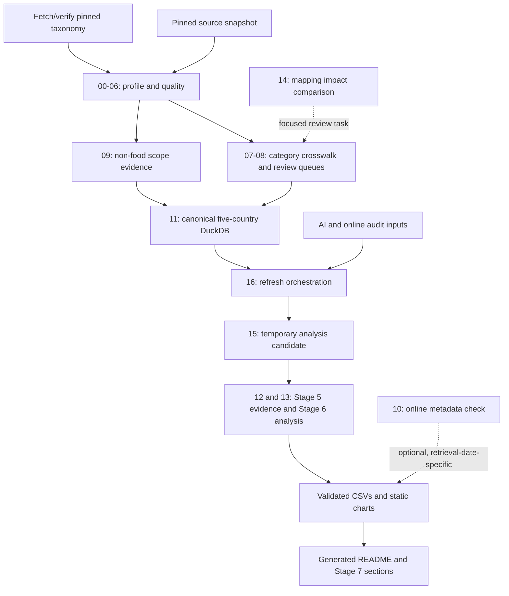

# Repository Architecture

This guide explains where project inputs, transformations, evidence, and published results live. The [README](../README.md) is the reader-facing summary; this page is the map for maintaining and reproducing the project.

## Repository map

| Path | Role | Change policy |
|---|---|---|
| `data/raw/` | Pinned Open Food Facts Parquet snapshot | Downloaded or verified by `scripts/00_download_snapshot.py`; excluded from Git. |
| `data/reference/` | ISO reference, reporting-group framework, diagnostic crosswalk, and pinned input manifest | Manifest and reviewed tables are versioned; taxonomy JSON is excluded from Git and retrieved by `scripts/support_fetch_pinned_taxonomy.py` with a size/hash check. |
| `data/mappings/` | Reviewed country, category, and brand decisions plus candidate anchors | Human-maintained inputs. Changes require a rationale and affected-output refresh. |
| `data/private/` | Unlabeled local audit sample and other private working inputs | Excluded from Git; never publish by accident. |
| `data/processed/` | Canonical five-country DuckDB build and temporary candidates | Generated, large, and excluded from Git. The full-country database is optional. |
| `scripts/` | Snapshot checks, profiling, mapping, database build, analysis, rendering, and validation | Scripts named `NN_*.py` identify ordered pipeline stages. `run_all.py` is the pipeline entry point; reusable helpers and developer tools use the `support_*.py` prefix. This separates workflow order from support code at a glance. |
| `sql/` | DuckDB schema, build, analysis, and validation statements | Numbered in execution order where they form a sequence. Some files contain Python-substituted placeholders and are not standalone SQL. |
| `outputs/profiling/` | Profile, mapping, coverage, and country-evidence CSVs | Generated. Only the explicitly allowlisted evidence tables are versioned. |
| `outputs/analysis/` | Stage 6 country, category, brand, and validation CSVs | Generated from the compact candidate; only allowlisted outputs are versioned. |
| `outputs/quality/` | Build checks, audit records, and refresh summaries | Generated. Published audit outputs are a documented record-level exception; other files remain ignored. |
| `docs/` | Numbered project, methods, results, release, and reproduction documentation | Filenames use two-digit order prefixes and lowercase snake case; `99_project_log.md` holds dated decisions. |
| `docs/img/` | Published static charts and repository preview artwork | Generated or prepared images referenced by the README and release notes. |
| `.github/workflows/` | Automated quality gates | Runs tests, Ruff lint/format over all Python scripts/tests, focused SQL lint, and generated-documentation consistency. |
| `tests/` | Small synthetic tests for mapping logic and analytical diagnostics | Does not require the source Parquet or large database. |

The root `README.md`, `LICENSE`, `requirements.txt`, and `requirements-dev.txt` keep their conventional names. They are intentional exceptions to the ordered documentation naming scheme.

## Data and execution flow

### Core pipeline

Run `scripts/run_all.py` for a clean reproduction. It downloads or verifies the pinned source, retrieves or verifies the locally excluded taxonomy, runs profiling and quality stages, generates the category crosswalk and review queues needed by the database build, builds the canonical five-country database, and delegates the Stage 5/6 refresh to `scripts/16_refresh_harmonized_analysis.py`.

The refresh script owns the downstream refresh sequence: when run alone it regenerates the category crosswalk and review queues, then builds a temporary candidate with `scripts/15_build_stage6_candidate_database.py`, generates and validates Stage 5/6 outputs through scripts 12 and 13, renders charts, and updates generated sections in the README and Stage 7 findings. The full pipeline passes `--skip-mapping-refresh` and `--skip-brand-profile-refresh` because it has just rebuilt those inputs and brand validation; this avoids repeating full Parquet scans. A standalone refresh runs both steps by default. Temporary database/output files are published only after validation passes.

| Script stage | Responsibility |
|---|---|
| `00` | Download or verify the pinned Parquet bytes. |
| `01`–`06` | Profile source structure, quality, countries, categories, brands, and taxonomy. |
| `07`–`08` | Build the category candidate crosswalk and its review queues. |
| `09` | Audit non-food scope and record-level sensitivity evidence. |
| `10` | Check selected claims against online metadata; optional and retrieval-date-specific. |
| `11` | Build and validate the canonical five-country DuckDB file. |
| `12`–`13` | Generate five-country evidence and run Stage 6 SQL analysis. |
| `14` | Measure the effect of a bounded category-mapping decision batch. |
| `15` | Build a temporary compact candidate for the validated Stage 6 refresh. |
| `16` | Orchestrate the candidate refresh, validation, charts, and generated documentation. |

Support scripts (`support_*.py`) retrieve the pinned taxonomy, prepare/evaluate the AI-assisted audit sample, render charts, render generated report sections from tracked CSVs, verify documentation, assert headline numbers, and expose shared inputs. `run_all.py` is the top-level pipeline entry point.

Support modules follow the same descriptive prefix and are grouped by responsibility: `support_nonfood_*` owns non-food scope queries and review evidence; `support_category_*` owns candidate crosswalk and country coverage calculations; `support_stage5_*` owns readiness and Stage 5 evidence metrics; `support_audit_*` owns semantic-audit classification and statistical calculations; and `support_render_*` plus `support_report_common.py` own generated report rendering. Stage 16 coordinates these modules instead of containing all report-generation logic itself.

Scripts 10 and 14 are focused tasks, not part of the clean core run. Script 10 checks external metadata and is retrieval-date-specific; script 14 measures the impact of a selected mapping decision batch. The AI-assisted semantic audit and its online evidence follow-up are explicit audit workflows described in the [reproduction guide](09_reproduction.md), not hidden steps in the core database build.

## Source of truth and generated artifacts

- The pinned source commit, expected file size, and checksum are documented in [the source record](02_data_source.md) and enforced by the downloader/build scripts.
- `scripts/support_duckdb_runtime.py` applies a 3 GB DuckDB memory limit and directs spill files to the ignored `data/processed/.duckdb_temp/` directory, with a 50 GB spill cap. This keeps build and query spill on the workspace volume instead of Windows? default temporary drive.
- `data/reference/pinned_sources.json` is the single code-level source for external input URLs, snapshot identifiers, sizes, hashes, and source dimensions. `scripts/support_pinned_inputs.py` exposes those values to the pipeline.
- Reviewed mapping CSVs and reference CSVs are inputs. Generated crosswalks and review queues are evidence; they do not approve candidate assignments by themselves.
- The five-country DuckDB file is the canonical analytical database. Stage 6 uses a compact temporary candidate and does not silently replace the optional full-country database.
- CSVs under `outputs/` are generated from the database and mapping inputs. `.gitignore` permits only named outputs to be versioned; changing that allowlist changes the publication boundary.
- The README metrics and Stage 7 result tables are generated by script 16. `scripts/support_check_docs_consistency.py` recomputes them and fails when the checked-in text drifts from its tracked evidence CSVs. When only the presentation changes, `scripts/support_rerender_generated_sections.py` re-renders the README and Stage 7 blocks from tracked CSVs without rebuilding the database or charts; `scripts/18_check_headline_numbers.py` asserts headline and derived numbers against the tracked CSVs and required static README strings.
- Other prose is maintained in its owning document: objective in the [business brief](01_business_brief.md), definitions in the [analysis specification](06_analysis_specification.md), workflow gates in the [workflow](04_analysis_workflow.md), and limitations/evidence in the [data profile](03_data_profile.md) and [findings](07_stage7_findings_and_recommendations.md).

## Change and validation path

1. State the decision or defect and locate its source input, transformation, output, and owning documentation.
2. Change the smallest authoritative input or transformation; do not edit generated CSVs or generated Markdown sections by hand.
3. Regenerate affected outputs using the documented command and preserve unresolved statuses where evidence is incomplete.
4. Run the relevant synthetic tests, Ruff, SQL lint for standalone SQL, and the documentation consistency check. A clean script exit alone does not establish analytical validity.
5. Review `git diff` for generated files, local databases, private samples, and changes outside the intended scope before publishing.

For exact commands, resource requirements, metric definitions, and the audit workflow, see the [reproduction guide](09_reproduction.md). For entity grain, keys, and relationships, see the [relational schema design](05_relational_schema_design.md).
