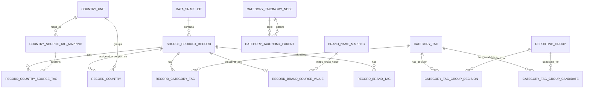

# Relational Schema Design

## Purpose and Status

The logical model and implementation assumptions below are approved for the initial relational build. The physical DuckDB schema is implemented by `sql/01_build_relational_database.sql`, validated by `sql/02_validate_relational_database.sql`, and orchestrated by `scripts/11_build_relational_database.py`. The database is a reproducible analytical derivative; the Parquet source remains unchanged.

The full Stage 4 database retains the earlier mapping state. For current Stage 5/6 work, `scripts/15_build_stage6_candidate_database.py` creates a separately validated 173,551,616-byte compact candidate containing only the required source projection, bridges, and mappings. It passed 13 checks, including content comparisons against the full database. This scope-limited candidate is not a full-schema rebuild, recovery copy, or replacement for the Stage 4 database.

Stage 2 is **sufficient to proceed to design, with mapping work deliberately deferred**. It is not a claim that every source value has been harmonized. Unresolved category tags remain explicitly represented in the crosswalk; unmapped brand values remain preserved in the raw source and are not treated as harmonized. Return to Stage 2 only when a concrete design or analysis requirement makes a specific decision material.

## Design Goals

- Preserve one row for every source Parquet row. Do not treat `code` as a primary key or deduplicate the 61 duplicate-code groups.
- Preserve the source snapshot, values, types, arrays, and structs without destructive rewriting.
- Model country, category, and brand associations so multi-valued fields do not cause accidental row multiplication.
- Keep exact source identifiers separate from canonical or reporting assignments.
- Make unresolved, excluded, candidate, and owner-approved mapping states auditable.
- Normalize only relationships required for the business questions. Keep other source arrays and nested fields in the raw record until a demonstrated analysis need justifies additional tables.

## Proposed Logical Entities and Grain

| Entity / relation | Proposed grain | Key and relationships | Purpose and status |
|---|---|---|---|
| `data_snapshot` | One row per source snapshot | `snapshot_id` primary key; source SHA-256 unique | Records the local file hash, byte size, row/column counts, and source path. Retrieval date remains unknown; extraction method is recorded as not determined. |
| `source_product_record` | One row per physical source Parquet row | `source_record_id` is the one-based Parquet row ordinal; unique `(snapshot_id, source_row_ordinal)`; `code` is non-unique | Landing table preserves all 111 source columns plus the snapshot ID and row-identity fields. No source row is filtered or deduplicated. |
| `country_unit` | One row per ISO 3166-1 alpha-2 reference unit | Unique `iso_alpha2` | All 249 entries in the project geography reference; the current mapped country profile reconciles 237 units with records. |
| `country_source_tag_mapping` | One row per exact raw country tag and mapping version | Unique `source_country_tag` for this build | Stores the reviewed mapping, classification, status, basis, and note. Mapping version is a SHA-256 over the mapping input. |
| `record_country_source_tag` | One row per source record and exact country tag | Unique `(source_record_id, source_country_tag)` | Retains tag-level lineage for the source's `countries_tags` assignments. |
| `record_country` | One row per source record and mapped ISO unit | Unique `(source_record_id, iso_alpha2)` | Counts a record once per ISO unit even if multiple exact source tags map to that unit. Derived only from approved mappings. |
| `category_taxonomy_node` | One row per exact taxonomy node and taxonomy version | Unique `(category_tag, taxonomy_version)` | Loads the full pinned taxonomy node inventory, English names, and direct parent tags. |
| `category_taxonomy_parent` | One row per taxonomy node and direct parent node | Unique `(child_tag, parent_tag, taxonomy_version)` | Preserves the pinned taxonomy as a graph, including multiple direct parents; does not flatten it into one inferred hierarchy level. |
| `category_tag` | One row per exact observed category tag | Unique `source_category_tag` | Stores exact source spelling/case and taxonomy-match facts from the generated crosswalk. |
| `record_category_tag` | One row per source record and exact category tag | Unique `(source_record_id, source_category_tag)` | Preserves many-to-many category-tag assignments, including tags later excluded or left unresolved. |
| `reporting_group` | One row per project reporting group | Unique `reporting_group_id` | Stores the approved group labels and display order. `other_unclassified` remains diagnostic-only. |
| `category_tag_group_decision` | One row per exact source category tag and mapping version | Unique `(source_category_tag, mapping_version)`; nullable selected group | Stores assignment/disposition status, selected owner-approved group when present, rationale, evidence tags, and the source's serialized co-occurrence evidence. Unresolved/excluded tags have no substantive selected group. |
| `category_tag_group_candidate` | One row per exact source category tag, mapping version, candidate group, and candidate role | Unique composite of tag, version, group, and role | Stores candidate groups and diagnostic residual membership separately from owner-approved decisions. |
| `record_brand_source_value` | One row per source record with a non-empty raw `brands` value | Unique `source_record_id` | Holds the complete raw `brands` field value. Multi-brand text is not split. |
| `brand_name_mapping` | One row per exact source brand text and mapping version | Unique `(source_brand_name, mapping_version)` | Stores the approved exact source-text mappings. Mapping version is a SHA-256 over the mapping file. |
| `record_brand_tag` | One row per source record and exact `brands_tags` value | Unique `(source_record_id, source_brand_tag)` | Preserves the separate `brands_tags` array. No equivalence to `brands` text is inferred. |

The brand entities are intentionally limited to source-value preservation and the existing explicit mapping. A final normalized `brand` entity and product-brand assignment bridge remain deferred until the project decides how to parse multi-brand text and how `brands_tags` relates to that field.

## Relationship Sketch

The DuckDB implementation uses unique indexes for the modeled key guarantees. It does not add foreign-key constraints; the validation SQL checks referenced units, groups, and taxonomy nodes before the build is accepted. Mapping versions are content hashes of their relevant reviewed inputs.

## Mapping and Query Rules

1. Load the raw Parquet snapshot without filtering records or expanding arrays into the raw record table.
2. Assign each ingested source row a surrogate `source_record_id`; keep its original ordinal within the snapshot. Enforce uniqueness on the surrogate and `(snapshot_id, source_row_ordinal)`, not on `code`.
3. Expand country/category/brand-tag arrays into association tables while preserving exact source values. Keep a separate `record_country` bridge that deduplicates only `(source_record_id, iso_alpha2)` after exact approved country mappings.
4. Store taxonomy parent edges independently of category-tag assignments. Use the category crosswalk as versioned candidate and decision inputs; preserve unresolved and excluded statuses, and do not auto-assign every candidate or residual tag as an approved analytical category.
5. Use brand mappings only for exact full `brands` text values listed in the mapping. No regex, similarity, implicit case-folding, delimiter splitting, or `brands`/`brands_tags` crosswalk is implied.
6. Build analytical views only after the schema and required mapping semantics are approved. Record-based counts remain distinct from code-based diagnostics; category/country/brand group totals can overlap.

## Approved Implementation Decisions

1. **Database target:** A DuckDB database file at `data/processed/global_product_landscape.duckdb`.
2. **Raw landing:** Retain all 111 source columns. Add `source_record_id`, `snapshot_id`, and `source_row_ordinal`; use the one-based Parquet row ordinal for stable record identity in this single-snapshot build.
3. **Brand handling:** Preserve exact full `brands` strings and `brands_tags` independently. Apply only the existing exact mapping file; do not split, case-fold, or infer equivalence.
4. **Category handling:** Preserve observed tags, taxonomy nodes/edges, owner decisions, candidates, and diagnostic-only statuses separately. Mapping work remains deferred unless an analysis requirement makes a specific decision material.
5. **Snapshot identity:** Use the source file SHA-256 as `snapshot_id`; preserve duplicate codes and validate all 61 known duplicate-code groups.
6. **Overwrite safety:** The builder refuses to overwrite an existing database. Use a new output path for a separate build; replace an existing database only through an explicit, owner-controlled file operation.

## Stage 3 Exit Criteria and Stage 4 Status

- Owner-approved database target, raw landing scope, and brand handling are recorded.
- The relational model accounts for duplicate codes, many-to-many country/category/brand tags, raw-value preservation, and unresolved mappings.
- Ordered SQL build and validation files exist under `sql/`, with `scripts/11_build_relational_database.py` as the guarded orchestration entry point.
- Stage 4 build and validation passed on the current pinned inputs. The database contains 4,828,207 source rows with all 111 source columns, the 61 known duplicate-code groups remain intact, 237 mapped ISO units reconcile exactly, and all 15 checks pass in `outputs/quality/database_build_validation.csv`. The report's 5,079,894 country assignments are source-record-to-country-tag links; the deduplicated `record_country` bridge contains 5,004,567 record-to-ISO rows. The ISO reference table contains all 249 reference units.

### Storage Footprint and Trade-off

A read-only audit on 2026-10-29 measured the Parquet at 7,975,461,945 bytes and the DuckDB file at 15,109,992,448 bytes. DuckDB reports 14.0 GiB (rounded), 57,588 used 256-KiB blocks, 52 free blocks, and no WAL. The database contains 16 tables and 15 unique indexes.

The database is not an uncompressed copy of the Parquet. Its source landing table preserves all 111 columns, including source arrays, while association tables materialize category, country-tag, record-to-country, and brand-tag relationships; unique indexes enforce modeled key guarantees. This supports raw-value auditability and relational queries but stores overlapping relationship information by design. DuckDB uses internal column compression; a per-table byte-accurate attribution has not been measured.

The owner prioritizes efficient storage as well as analytical quality. Before any future schema/storage redesign, compare the current design with alternatives such as treating the pinned Parquet as the canonical raw table and storing only required derived fields, or retaining only indexes justified by actual validation/query needs. Test a separate candidate build, validate all analytical outputs and recovery requirements, and compare query performance and disk use. Do not delete the current database or remove indexes based only on file size.
